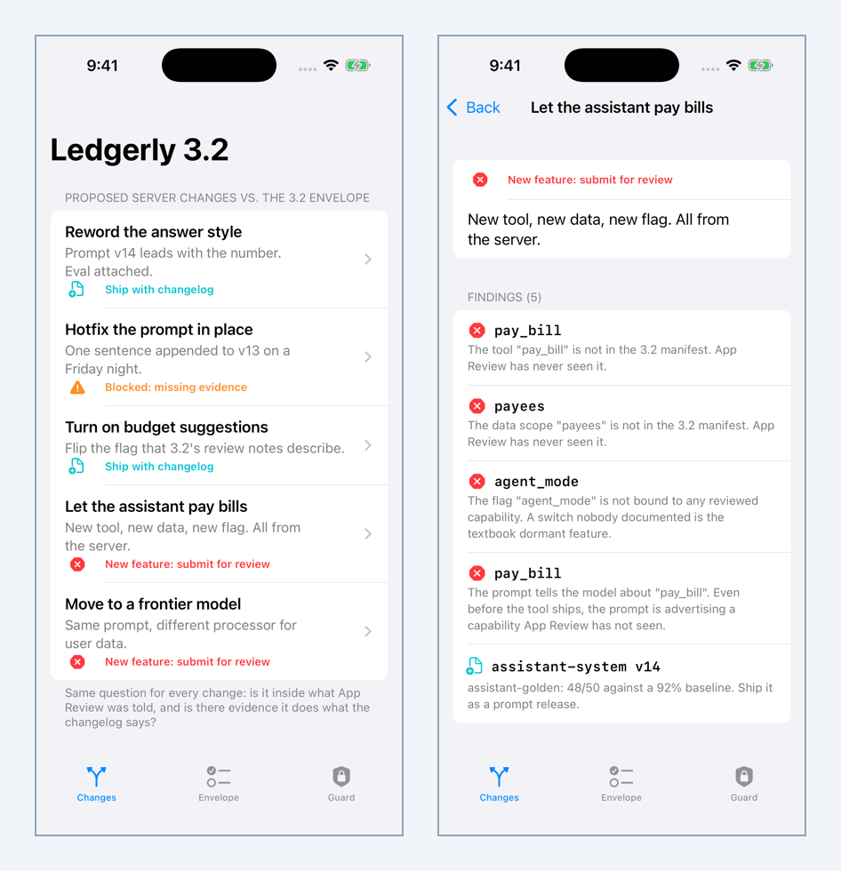
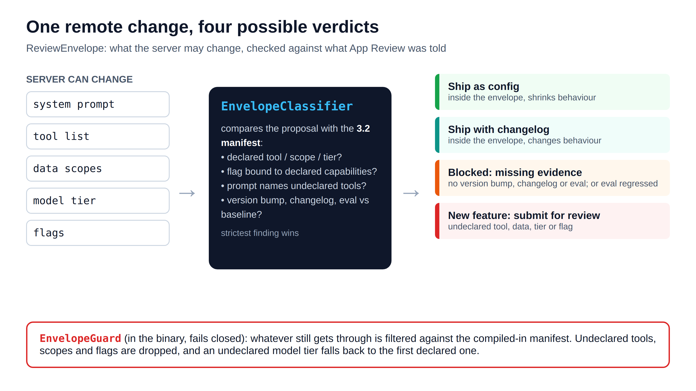

# ReviewEnvelope

**Guideline 2.5.19 for AI features: decide which remote changes are configuration and which are new features, and make the binary enforce it.**

Article: [Under Guideline 2.5.19, Treat Your Remote AI Prompt Like a Release. Here’s Where I Draw the Line.](https://medium.com/@er.rajatlakhina/under-guideline-2-5-19-treat-your-remote-ai-prompt-like-a-release-heres-where-i-draw-the-line-178e53100e89)

On 16 Oct 2026 Apple added [App Review Guideline 2.5.19](https://developer.apple.com/app-store/review/guidelines/): no hidden, dormant or undocumented features. An AI assistant's behaviour mostly lives on a server (the system prompt, the tool list, the data the model reads, the model tier and the flags), so "the code path was in the binary" is not a useful test. This package uses a different one:

> Is this behaviour inside the envelope we documented to App Review, and do we have evidence it does what the changelog says?





## What's in it

| Type | Job |
|------|-----|
| `CapabilityManifest` / `Capability` | The reviewed envelope for one app version: features (with reviewer steps), AI tools, data scopes, model tiers, and remote flags with exactly what each may unlock. `validate()` catches duplicate ids, features a reviewer can't reach, flags bound to unknown capabilities, and a manifest with no model tier. |
| `ManifestDiff` | What's new since the version App Review last saw. |
| `ReviewNotes.render` | Plain-text appendix for the Notes for Review field, generated from the same manifest the server and the app enforce. |
| `RemoteBehavior` / `PromptRelease` / `EvalResult` | The server payload, and the evidence attached to a prompt change (changelog + eval run vs the production baseline). |
| `EnvelopeClassifier` | Returns findings and a verdict: **ship as config**, **ship with changelog**, **blocked** (missing evidence), or **new feature** (submit for review). The strictest finding wins. |
| `PromptToolReferences` | Finds backticked `snake_case` tool names in the prompt, so a prompt that advertises an undeclared tool is caught before the tool ships. |
| `EnvelopeGuard` | Runs in the app and fails closed: undeclared tools, data scopes and flags are dropped, and an undeclared model tier falls back to the first declared one. |
| `SampleLedgerly` | A fictional finance app with five proposed changes. Every verdict on screen is asserted in the tests. |

```swift
let classifier = EnvelopeClassifier(manifest: SampleLedgerly.manifest)
let result = classifier.review(current: SampleLedgerly.production,
                               proposed: change.proposed,
                               release: change.release)
switch result.verdict {
case .shipAsConfig, .shipWithChangelog: push(change)
case .blocked: askForEvidence(result.findings)
case .needsSubmission: planABuild(result.findings)
}
```

```swift
let admission = EnvelopeGuard(manifest: SampleLedgerly.manifest).admit(payload)
assistant.configure(with: admission.admitted)   // never more than 3.2 was reviewed with
```

## The five Ledgerly scenarios

| Change | Verdict | Why |
|--------|---------|-----|
| Reword the answer style (prompt v14) | Ship with changelog | Version bumped, changelog, eval 47/50 vs a 92% baseline |
| Hotfix the prompt in place | Blocked | Text changed without a version bump, no changelog, no eval |
| Turn on budget suggestions | Ship with changelog | The flag, tool and data scope are all declared in 3.2 |
| Let the assistant pay bills | New feature | Undeclared tool, data scope and flag, and the prompt names `pay_bill`. The eval passing at 48/50 doesn't change that |
| Move to a frontier model | New feature | User data goes to a tier the manifest doesn't declare |

## How to run it

```bash
git clone https://github.com/rajatslakhina/review-envelope-article-demo.git
cd review-envelope-article-demo
open Demo.xcodeproj
```

Pick any iPhone Simulator and press Build & Run. Nothing else to set up: `Demo.xcodeproj` uses the package through a local package reference. The library tests run with `swift test`.

The demo has three tabs: **Changes** (the five scenarios and their findings), **Envelope** (the 3.2 manifest and the generated Notes for Review appendix) and **Guard** (the pay-bills payload going into the binary and what actually runs).

## Verification status

- `swift build -Xswiftc -warnings-as-errors` and `swift test` (21 tests, 0 failures) pass on Linux (Swift 6.1.2), and in the `library` CI job on macOS (macos-15).
- The `demo-on-simulator` CI job builds `Demo.xcodeproj`, installs it on an iOS Simulator, launches each screen, checks the process is still alive, and saves the screenshots in `Demo/Screenshots/`.
- The app was not run by hand in a local Xcode.

## Caveat

This is one lead's working policy, not Apple's. App Review may draw some of these lines differently. The point is to make your disclosure honest and have the build enforce it.

MIT licensed.
